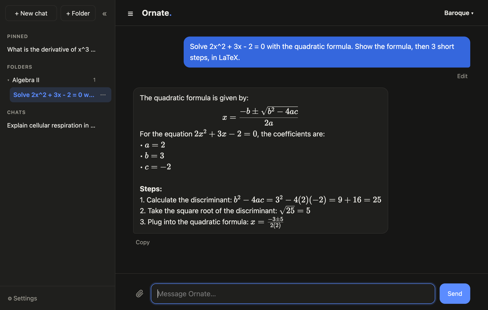
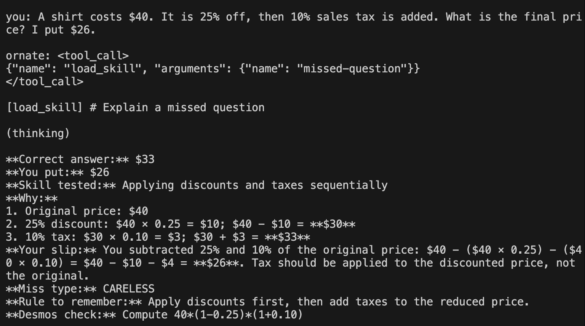
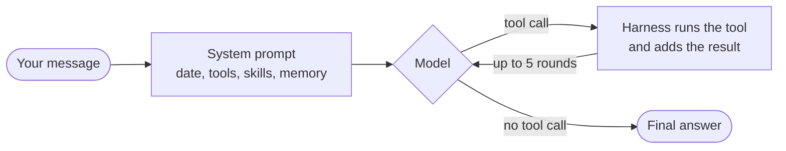

<div align="center">

# Ornate

**A local AI agent that runs entirely on a MacBook.**<br>
No cloud model, no API key: a 30B open model, an agent loop written from scratch, and a chat app in the browser.


[Features](#features) · [Quick start](#quick-start) · [Results](#results-at-a-glance) · [What I found](#what-i-found) · [How it works](#how-it-works) · [Full evals](EVALS.md)



<sub>I put $26 on a discount-and-tax problem. Ornate loads its missed-question skill on its own, checks the math in Python, and finds the slip: both percentages taken off the original price, $40 − $10 − $4 = $26.</sub>

</div>

<br>

Ornate can run Python to check its math, search the web, read PDFs, remember things across chats, and load skills on its own, such as working out exactly how I got a practice question wrong. Every part is measured with evals I wrote, and the most useful results were the failures they caught.

## Results at a glance

All on the 30B-A3B model unless noted. Each set is small, so a gap of one or two is noise.

| Eval | Result |
|---|---|
| Math, 50 hard problems | **50/50** with the Python tool, 48/50 without |
| Math, 45 problems the prompt never saw | **45/45** with the reasoning prompt, 44/45 with the original |
| Naming the exact mistake behind a wrong answer, 9 problems | **8/9** with thinking, 6/9 without |
| Picking the right first move, 30 messages | **30/30** |
| Saving and forgetting on a fake memory list, 13 messages | **12/13** |
| 30B mixture-of-experts vs 32B dense | about **8× faster**, same or better scores |

## Features

| | |
|---|---|
| **Agent loop** | Written from scratch, no framework. The model calls tools, the harness runs them and loops until it answers. |
| **Tools** | Python execution, web search, PDF and text files, memory |
| **Skills** | Instruction files the model loads on its own when a request matches (mistake analysis, quizzes) |
| **Adaptive thinking** | Off for quick decisions, on after a skill or search, when the hard reasoning starts |
| **Memory** | Saves and deletes only when asked, and deletes only after a "yes" in the chat |
| **Web app** | Streaming answers, tool status, message queue, memory panel, copy buttons, message editing, saved chats with folders and pins, model picker (Baroque = 30B, Filigree = 8B), LaTeX math, drag-and-drop text files and PDFs |
| **Evals** | Math, routing, skills, memory, and model comparisons, with saved transcripts |

## Quick start

Requires a Mac with Apple Silicon and about 17 GB of free memory. Built and tested on a MacBook Pro (M1 Max, 64 GB); all timings in this repo come from that machine.

```
git clone https://github.com/rpatel-23/ornate.git
cd ornate
python3 -m venv .venv && source .venv/bin/activate
pip install mlx mlx-lm numpy sympy pypdf ddgs fastapi uvicorn
```

**Chat in the browser:**

```
uvicorn server:app --port 8000
```

Then open http://localhost:8000.

**Or in the terminal:**

```
python agent.py
```

The first run downloads Qwen3 30B-A3B (17 GB). For a smaller machine, use the 8B model (5 GB):

```
ORNATE_MODEL=mlx-community/Qwen3-8B-4bit python agent.py
```

Terminal commands: `/file <path>` attaches a file, `/quiz <topic>` starts a quiz, `/style roast` or `/style plain` switches personality, `/memory` and `/forget <n>` manage memory, `q` quits.

<details>
<summary>What the terminal version looks like</summary>
<br>



</details>

## What I found

Full numbers and transcripts are in [EVALS.md](EVALS.md).

- **A calculator made the model worse.** A 14B model scored 48/50 on math by reasoning and 46/50 with a Python tool. Told to use code for every calculation, it stopped thinking and trusted quick, wrong scripts.
- **The score hid a broken tool.** My Python tool returned nothing when code ended with a bare variable, so the model retried until it ran out of turns. Fixing it took the 8B from 45/50 to 49/50. I found it by reading transcripts, not scores.
- **A prompt that aced one test didn't generalize.** A new prompt took the 14B from 46/50 to 50/50. On 45 fresh problems it gained at most one question. Most of the gain came from fitting the prompt to the test.
- **Thinking helps hard work and hurts quick decisions.** With thinking on, the model found my exact mistake on 8 of 9 problems instead of 6, but routed slightly worse and took three times as long. So Ornate thinks only after it picks a skill or searches.
- **Search found the answer and the model ignored it.** The correct Super Bowl result was in its search results, and it answered with an older game. Putting today's date in the prompt and thinking after a search fixed it.
- **A bigger model was slower and no better.** A dense 32B model ran about 8 times slower than the 30B mixture-of-experts model Ornate uses, scored the same or lower, and made worse deletions.
- **Anything that matters should be decided by code, not the model.** The model mis-scored quizzes, said "remembered." without saving, and deleted the wrong fact when asked to forget something it didn't have. Quiz scoring, saving, and deleting are now handled in Python.
- **A safety check caused the bug it was built to stop.** To catch fake saves, I scanned answers for words like "stored". Then a photosynthesis explanation ("energy is stored in glucose") came back as "Already saved." The check now looks only at what the user typed, and `test_checks.py` covers ordinary sentences that must never trigger it.
- **One line of the prompt made "what do you know about me?" try to delete everything.** The forget instructions read so much like the question that the model called `forget` on every saved fact, and three other ways of asking did the same. Even the date at the top of the prompt changed which ones failed, so rewording was not a fix. Now `forget` refuses unless the user's message asks to delete, and with the line removed the model stopped trying.

## How it works



- **Agent loop** (`harness.py`). The model can only produce text, so tools are described in the prompt. When it writes a tool call, the harness runs it, adds the result to the conversation, and asks again.
- **Tools** (`assistant.py`). `run_python` runs code in a separate process with a 10-second timeout. `web_search` returns five DuckDuckGo results, labeled as website text so the model treats them as information, not instructions.
- **Skills** (`skills/`). Markdown files listed in the prompt with one line each. The model loads the full file when a request matches, and the harness removes it after the answer so it doesn't leak into later messages.
- **Quizzes** (`quiz.py`). The model writes the questions as JSON once; Python runs the quiz and keeps score.
- **Memory** (`memory.py`). Facts are stored in `memory.json` and added to every prompt. Code checks the user's message before any save, and deletes only after a "yes".
- **Web app** (`server.py`, `static/index.html`). A FastAPI server streams each piece of the answer to the page as JSON, with tool events. A lock queues requests, since one model writes one answer at a time. Chats are saved as JSON files on the Mac (`chats.py`), and a sidebar lists them with pins and folders. The page is one file. Its only outside library is KaTeX, which draws math and loads from a CDN; offline, math shows as plain text.
- **Tiny GPT** (`gpt.py`). Before using a real model, I wrote a character-level transformer and trained it on Shakespeare to understand what is inside one: 816,705 parameters, validation loss 1.62 against 4.17 for random guessing.

## Tests

```
python test_checks.py    # code-side checks for memory, no model needed (under a second)
python eval_routing.py   # does it pick the right first move? (30 messages)
python eval_memory.py    # forget requests and memory questions against a fake memory list (13 messages)
python eval_hard.py      # 50 math problems, with and without the Python tool
python eval_skill.py     # 9 missed questions, graded by reading the output
```

Results are saved to `results/` with full transcripts.

## Limits

- A 30B local model is well below frontier models, especially on long, multi-step tasks.
- The test sets are small (9 to 50 items), and I wrote both the tests and the prompts. Gaps of one or two are noise.
- `run_python` runs model-written code on the machine without a sandbox.
- Web search uses an unofficial package and only sees short snippets.
- The web app reads text files and PDFs, not images or Word files.
- Nothing is fine-tuned. The models are stock Qwen3 weights from [mlx-community](https://huggingface.co/mlx-community).
- Memories stay in `memory.json` on your machine, which is git-ignored.

## Roadmap

- [x] Tiny GPT from scratch
- [x] Agent loop, tools, skills, and evals
- [x] Memory
- [x] Web app with streaming
- [x] Saved chats with folders and pins
- [x] Web app design pass: blue accent, LaTeX math, drag-and-drop files
- [ ] Reading photos of worksheets (vision)
- [ ] Search over class notes (RAG)
- [ ] Running code in more languages, in a sandbox
- [ ] Fine-tuning with before and after evals
- [ ] Windows port for an RTX 4070 laptop

## Notes

Built as a learning project, using Claude as a tutor to explain concepts, write parts of the code, and review mine.
