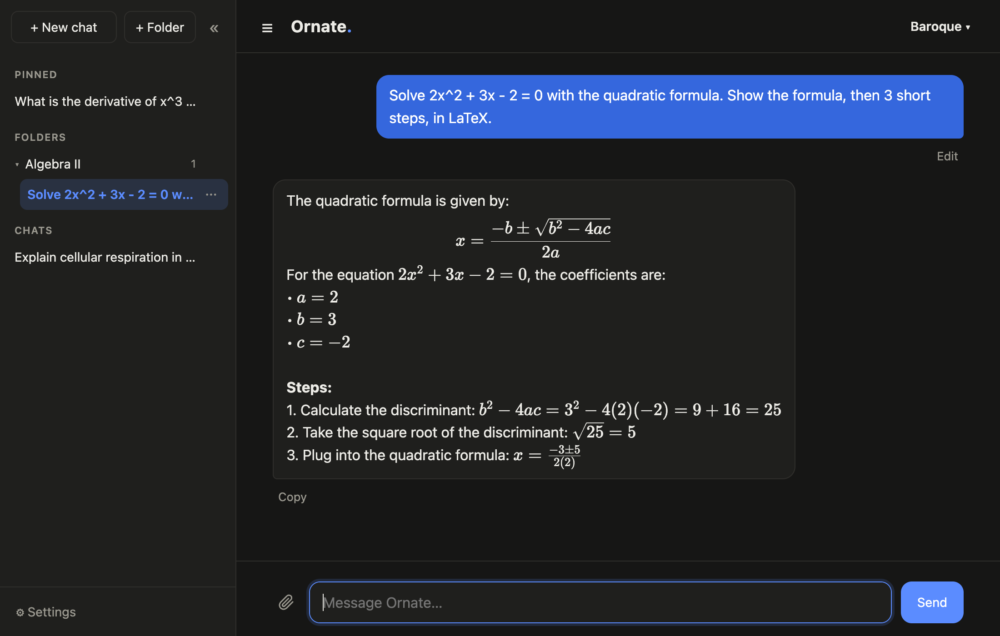
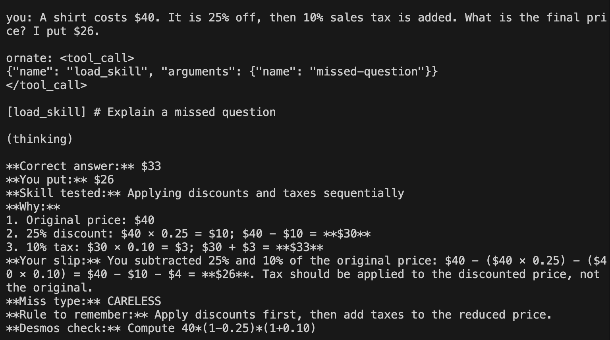
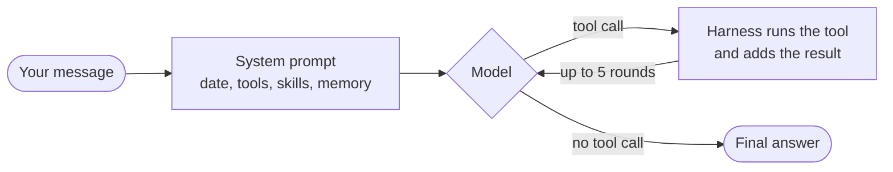

<div align="center">

# Ornate

**A local AI agent that runs entirely on a MacBook.**<br>
A 30B open model, an agent loop written from scratch, and a chat app in the browser. No cloud, no API key.


[Results](#results) · [Features](#features) · [Quick start](#quick-start) · [How it works](#how-it-works) · [Findings](docs/findings.md) · [Full evals](EVALS.md)



</div>

Ornate runs Python to check its math, searches the web, reads PDFs, remembers things across chats, and loads skills on its own, like working out exactly how I got a practice question wrong. Every part is measured with evals I wrote.

## Results

On Baroque, Ornate's default model (stock Qwen3 30B-A3B-Instruct-2507, 4-bit).

| Math | Ornate | Same model, no tools |
|---|---|---|
| MATH-500, 500 competition problems | **95.0%** | 96.2% |
| 45 held-out problems | **45/45** | 39/45 |
| 50 hard problems | **50/50** | 50/50 |

| Agent behavior | Score |
|---|---|
| Write and run code, 15 tasks | **15/15** |
| Pick the right first move, 30 messages | **29/30** (28 on some dates) |
| Same, with a file attached, 17 messages | **17/17** |
| Writing vs counting tasks on a file, 13 | **10/13** |
| Save and forget on a fake memory list, 13 | **12/13** |
| Multi-turn conversations, 11 | **11/11** |
| Name the exact mistake behind a wrong answer, 9 | **7/9** |

Agent scores include Ornate's code checks. Most sets are small, so a gap of one or two is noise. Model-alone scores, other models and every transcript: **[EVALS.md](EVALS.md)**.

## Highlights

- **Tools help arithmetic, not competition math.** Python takes the model from 39/45 to 45/45 on arithmetic-heavy problems, but makes no measurable difference on MATH-500.
- **A calculator made a model worse.** Told to use code for every calculation, a 14B model stopped reasoning and trusted quick, wrong scripts (48/50 → 46/50).
- **A prompt that aced one test didn't generalize.** 46/50 → 50/50 on the test it was written for, at most +1 on 45 fresh problems.
- **Where a file sits in the message changed what the model did.** With the file after the request, it "fixed grammar" with `text.replace("is", "are")`. Moving the file first took these tasks from 8/13 to 10/13, with no prompt change.
- **Code decides what matters, not the model.** Quiz scoring, saving, and deleting memories are checked in Python after the model mis-scored quizzes and deleted the wrong fact.

**[All 14 findings →](docs/findings.md)**

## Features

| | |
|---|---|
| **Agent loop** | From scratch, no framework: the model calls tools, the harness runs them, up to 5 rounds |
| **Tools** | Python, web search, PDF and text files, memory |
| **Skills** | Instruction files the model loads when a request matches (mistake analysis, quizzes) |
| **Memory** | Saves only when asked; deletes only after a "yes" |
| **Model picker** | Baroque (default), Filigree (8B, light), Mosaic (thinks first), Art Deco (code) |
| **Web app** | Streaming with Stop, saved chats with folders and pins, LaTeX math, drag-and-drop files |
| **Safety nets** | Stops answers that loop, caps tool output, asks the model to fix crashed code |

## Quick start

Needs a Mac with Apple Silicon and ~17 GB of free memory. Built on an M1 Max (64 GB).

```
git clone https://github.com/rpatel-23/ornate.git
cd ornate
python3 -m venv .venv && source .venv/bin/activate
pip install mlx mlx-lm numpy sympy pypdf ddgs fastapi uvicorn
uvicorn server:app --port 8000      # then open http://localhost:8000
```

The first run downloads the model (17 GB). Smaller Mac? Use the 8B (5 GB): `ORNATE_MODEL=mlx-community/Qwen3-8B-4bit`.

<details>
<summary>Terminal version</summary>
<br>

```
python agent.py
```

Commands: `/file <path>`, `/quiz <topic>`, `/style roast` or `/style plain`, `/memory`, `/forget <n>`, `q` to quit.



</details>

## How it works



| File | What it does |
|---|---|
| `harness.py` | Agent loop, model loading, reading tool calls, `run_python` (separate process, 10 s timeout) |
| `assistant.py` | Tools, skills, system prompt, and the code checks around memory |
| `skills/` | Markdown instructions, loaded on demand and removed after the answer |
| `quiz.py` | The model writes questions once; Python runs the quiz and keeps score |
| `server.py`, `static/` | FastAPI server streaming to a one-file web page |
| `gpt.py` | A tiny GPT I trained on Shakespeare first, to see what's inside a model |

## Tests

```
python test_checks.py      # code checks, no model (< 1 s)
python eval_routing.py     # right first move (add --tests routing_file_tests.json for files)
python eval_memory.py      # save and forget
python eval_multiturn.py   # short conversations
python eval_hard.py        # 50 math problems, with and without tools
python eval_coding.py      # 15 write-and-run tasks
python eval_math500.py     # MATH-500 (2 to 5 hours)
```

Every run saves full transcripts to `results/`.

## Limits

- A 30B local model is well below frontier models on long, multi-step work.
- Most test sets are small, and I wrote both the tests and the prompts.
- `run_python` isn't sandboxed.
- No fine-tuning: stock Qwen3 weights from [mlx-community](https://huggingface.co/mlx-community).

## Roadmap

- [ ] Picking the right model automatically
- [ ] Windows port (RTX 4070 laptop)
- [ ] Reading photos of worksheets (vision)
- [ ] Search over class notes (RAG)
- [ ] Sandboxed code in more languages
- [ ] Fine-tuning with before-and-after evals

<details>
<summary>Done so far</summary>

- [x] Tiny GPT from scratch
- [x] Agent loop, tools, skills, and evals
- [x] Memory with code-side checks
- [x] Web app: streaming, saved chats, folders and pins, math, file uploads
- [x] MATH-500, coding and multi-turn evals; thinking and code models in the picker

</details>

## Notes

Built as a learning project, using Claude as a tutor to explain concepts, write parts of the code, and review mine.
